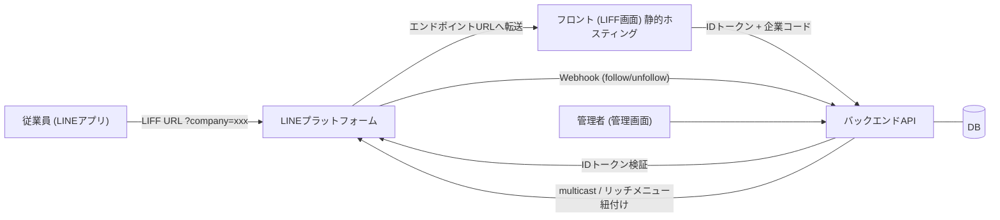
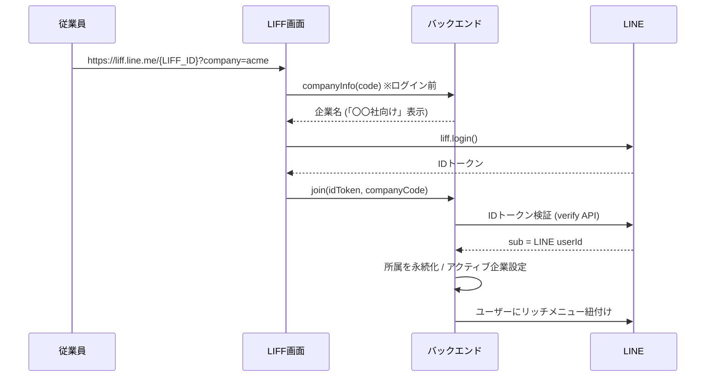

# 引き継ぎ資料: LIFF × LINE 企業別配信 (GASホットモックの結果とAWS新規構築に向けた設計)

作成日: 2026-10-23 / リポジトリ: https://github.com/ryotanom3/line_test

## 0. この資料の位置づけ

- 個人環境の GAS + スプレッドシート + GitHub Pages で**ホットモック**を作り、LINE連携の方式が成立することを実機で確認した。
- 本番は社用 AWS に**新規構築**する(モックの移植ではない)。
- GAS を使った理由: 社用 Google Workspace では、GAS への外部からの Webhook が弾かれるため。個人環境で方式検証だけ行った。
- モックのコードは参考実装であり、**設計とLINE仕様上の知見(§5, §6)が主な引き継ぎ対象**。

## 1. サービス要件(再掲)

- ユーザーは複数企業の従業員。複数企業・複数従業員が利用する。
- 企業配布のQR/URLから、LINE公式アカウントを友だち追加して情報を受け取る。
- 公式アカウントはサービス提供者として**1本のみ**。所属企業ごとに情報(メッセージ・リッチメニュー)を出し分ける。
- **制約**: 従業員・企業の個人情報はLINE側に持たせず、サービス側のサーバーで管理する。LINE側に持たせるのは、LINEユーザーID(userId)のみ。
- 後続: サービスへの利用登録後に、LINE userId とサービスユーザーIDを紐付ける。

## 2. 全体アーキテクチャ(モック)

| 役割 | モック | AWS想定 |
|---|---|---|
| LIFF画面/管理画面 | GitHub Pages | S3 + CloudFront |
| API | GAS Webアプリ (`doPost`) | API Gateway + Lambda |
| DB | スプレッドシート | DynamoDB (または RDS) |
| 秘密情報 | スクリプトプロパティ | Secrets Manager / SSM Parameter Store |

## 3. LINE側の構成

- **同一プロバイダー**内に次の2チャネルを作る(別プロバイダーだと userId が一致せず、pushできない)。
  - LINEログインチャネル: LIFFアプリを登録する。
  - Messaging APIチャネル: 公式アカウント。メッセージ送信、リッチメニュー、Webhook。
- LINEログインチャネルの「リンクされたLINE公式アカウント」に、公式アカウントを設定する。
- LIFFアプリの設定:
  - エンドポイントURL: フロントのURL
  - Scope: `openid` `profile`
  - 友だち追加オプション: On (Normal または Aggressive)(上記の公式アカウントのリンクが前提)
- Messaging API側: あいさつメッセージ・応答メッセージをOFF。WebhookをONにして、バックエンドURLを設定する。

## 4. 主要フロー

### 4.1 企業URLからの参加(企業所属の登録)

### 4.2 サービス利用登録との紐付け

1. 既存の利用登録導線で、サービスユーザーIDが発行される。
2. 登録完了画面で、**ワンタイム連携URL**(`liff.line.me/{LIFF_ID}?link=TOKEN`)をボタン/QRとして提示する。
   - LINE連携は登録導線の最後に置く(登録のCVを阻害しないため)。
3. ユーザーがLIFFを開いてログイン → バックエンドが、IDトークン検証で得た userId と、TOKENに紐づくサービスユーザーIDを紐付ける。TOKENは使用済みにする。
4. 本人確認はサービス側の認証(社員番号など)で済んでいるため、LINE側では「TOKENを持つ人」を結ぶだけでよい。

### 4.3 企業別配信

- 企業に所属する userId の一覧を、バックエンドのDBから引く。
- Messaging API の multicast を呼ぶ(**1リクエスト最大500ID**)。500件ごとに分割する。
- アクティブ企業に関係なく、所属する全企業の配信を受ける。

## 5. データモデル(モックのシート構成 → 本番の叩き台)

| テーブル | 主なカラム | 備考 |
|---|---|---|
| companies | code, name, enabled, richmenu_id | 企業コード → 企業名のマッピング。企業ごとにリッチメニューIDを持つ |
| line_users | line_user_id, display_name, followed, active_company | `active_company` = 表示中メニューの企業。`followed` は follow/unfollow Webhook で更新 |
| memberships | line_user_id, company_code, service_user_id, joined_at, linked_at | **LINEユーザー×企業**の所属。**紐付けは所属単位**(複数企業所属だと、サービスユーザーIDが企業ごとに別になりうるため) |
| link_tokens | token, service_user_id, expires_at, used | ワンタイム連携トークン |
| send_log | at, company_code, text, target_count, result | 配信ログ |

DynamoDB化する場合の例:
- `memberships`: PK=`line_user_id`, SK=`company_code`、GSI: PK=`company_code`(企業別配信の対象取得用)
- `link_tokens`: TTL属性で自動削除

## 6. 実機検証で分かった注意点(LINE仕様・ハマりどころ)

### 認証・トークン
- ID トークン(`openid` scope)を `POST https://api.line.me/oauth2/v2.1/verify`(`id_token`, `client_id`=**LINEログインチャネルID**)で検証すると、`sub` に userId が入る。`name` は `profile` scope で入る。
- **IDトークンの有効期間は約1時間**。LIFFが古いトークンを保持していることがあり、`IdToken expired.` になる。
  - 対策: `liff.getDecodedIDToken().exp` を確認し、期限切れ・検証エラー時は `liff.logout()` → `liff.login()`。無限ループ防止のガードを入れる。
- LINEアプリの「連動解除」をすると、アクセストークンが失効する(`The access token revoked`)。外部ブラウザには古い情報が残りやすく、動作確認は**LINEアプリ内ブラウザ**で行うこと。
- 友だち追加の確認ダイアログ(ログイン同意画面)は、**同意済みのアカウントには再表示されない**。やり直すには、LINEの設定 → アカウント → 連動アプリ で、連携を解除する。

### 友だち追加
- 友だち追加を促すには、LINEログインチャネルに公式アカウントをリンクし、LIFFの友だち追加オプションをOnにする(§3)。
- `liff.getFriendship()` は LINEアプリ内で `profile` scope が前提。取得失敗時も友だち追加の導線は出す。
- 友だちでないユーザーには、push/multicastもリッチメニュー紐付けもできない。

### リッチメニュー
- **1ユーザーに紐付けられるのは1つだけ**。複数企業所属の場合は「アクティブ企業」を持たせ、LIFFから切り替える(切替時にユーザー単位の紐付けをやり直す)。
- 作成の流れ: `POST /v2/bot/richmenu` → 画像アップロード(`api-data.line.me/.../content`、2500×843のPNG等)→ ユーザーへ `POST /v2/bot/user/{userId}/richmenu/{richMenuId}`。
- **メニュー作成より前に参加済みのユーザーには自動で付かない**。メニュー作成時に、既存の所属ユーザーへも紐付けること(実装済み)。
- ユーザー個別のメニューは、公式アカウントのデフォルトメニューより優先される。
- 紐付け失敗を握りつぶすと原因が分からなくなる。APIのレスポンスをログ/管理画面で確認できるようにしておく(モックには「メニュー再適用」ボタンがある)。

### GASに起因する制約(本番では解消される)
- ヘッダーを読めないため、**Webhookの署名検証 (`x-line-signature`) ができない**。AWSでは必須。
- CORSのプリフライトに対応しないため、`Content-Type: text/plain` でPOSTしていた。本番では適切なCORS設定にする。
- GASのHTML Service(iframe)上でLIFFを動かすのは不安定なため、フロントは静的ホスティングに分離した。
- デプロイ: コード更新後は「デプロイを管理 → 新バージョン」を行わないと `/exec` に反映されない。

## 7. モックで確認できたこと / 未確認のこと

確認済み(実機):
- 企業URL(`?company=`)でログイン前に企業名を表示
- LINEログイン → IDトークン検証 → userId・企業の永続化
- 友だち追加の促進
- 企業別の multicast 配信
- 企業別のリッチメニュー表示
- 連携URL(`?link=`)によるサービスユーザーIDの紐付け

未確認:
- 複数企業所属時のメニュー切替(`switchCompany`)の実機確認
- Webhook(follow/unfollow)の受信と、`followed` の更新(モックの管理画面で `?` のまま)
- 大量ユーザー(500人超)の分割配信
- LINEの配信上限・レート制限

## 8. AWS新規構築で決めること / 提案

### 構成案
- フロント: S3 + CloudFront(LIFFのエンドポイントURL、管理画面もここ)
- API: API Gateway(HTTP API) + Lambda
  - 公開API: `companyInfo`, `join`, `me`, `switchCompany`, `link`
  - 管理API: 企業管理、配信、メニュー作成/再適用、連携トークン発行
  - Webhook: `/webhook`
- DB: DynamoDB(§5)
- 秘密情報: Secrets Manager(Messagingのチャネルアクセストークン、チャネルシークレット)
- 配信: 件数が多い場合は SQS + Lambda でバッチ送信(multicast は1回500件まで)

### Webhook
- **署名検証を必須**にする: `x-line-signature` を、チャネルシークレットでHMAC-SHA256した**生ボディ**と照合する。
  - API Gateway/Lambda では、base64化されたボディの扱いに注意する。
- 200を速やかに返し、重い処理は非同期にする。
- 受けるイベント: `follow`(メニュー再適用・`followed` 更新)、`unfollow`(`followed` 更新)。

### セキュリティ
- 管理画面は共有キーではなく、Cognito や IAM Identity Center 等で認証する。
- 企業コードは「招待コード」の位置づけ。推測されにくいランダム値にし、企業の無効化・期限を設けることを推奨する(リクエスト元はクライアントなので信頼しない)。
- 連携トークンは、短い期限・1回限り・レート制限を設ける。紐付け済みユーザーの二重連携の扱いを決める(モックは、同一企業で別ユーザーに紐付け済みならエラー)。
- IDトークンの検証は、まずは verify API でよい。負荷が問題になるなら、JWKS による署名のローカル検証も検討する。

### 個人情報
- LINE側には userId 以外を持たせない。
- `display_name`(LINEの表示名)をサービス側に保存するかは、要判断。必要がなければ保存しない。

### 要確認事項(オープン)
1. サービス側のIDは、1人1IDか、企業ごとにIDが発行されるのか(紐付け単位に影響)。
2. 複数企業所属時のメニューの考え方
   - 「アクティブ企業」方式でよいか
   - 1つのメニューに企業切替ボタンを置く方式に寄せるか
3. 配信対象の粒度(企業単位のみ / 部署・属性単位まで必要か)。属性が増えるなら、Narrowcast API の audience 機能も候補。
4. 配信するコンテンツの種類(テキストのみか、Flex Message、画像等か)。
5. 本番の公式アカウントの運用ルール(複数環境の分離: 開発用・検証用のチャネルを別に作るか)。

## 9. 参考実装(リポジトリ)

| ファイル | 内容 |
|---|---|
| `gas/Code.gs` | APIの全アクション。LINE API呼び出し方法の参照実装(`verifyIdToken_`, `broadcast_`, `setupRichMenu_`, `applyRichMenu_`, `link_`) |
| `docs/index.html` | LIFF画面。ログイン、トークン期限切れ時の再ログイン、友だち状態の確認、企業切替 |
| `docs/admin.html` | 管理画面(企業管理、配信、連携URL発行、メニュー再適用) |
| `docs/config.js` | フロント設定(LIFF ID、API URL、友だち追加URL) |
| `tools/make_richmenu_images.py` | リッチメニュー用のダミー画像生成 |
| `README.md` | モックのセットアップ手順 |

流用の目安:
- そのまま流用できる(ロジックと知見): LINE APIの呼び出し手順、LIFF画面の制御(`index.html` の再ログイン処理)
- 作り直す: 永続化層(シート → DynamoDB)、認証(管理画面)、Webhook受信(署名検証)、配信の非同期化

## 10. 注意: リポジトリの取り扱い

- リポジトリには、アクセストークンやチャネルシークレットは含まれていない(GASのスクリプトプロパティ)。
- `docs/config.js` には LIFF ID と GAS の URL が入っている。個人検証用の値なので、社用環境では使わない。
- モック用のLINEチャネルは個人アカウントのもの。社用環境では、会社のLINE公式アカウントとプロバイダーを別途準備する。
